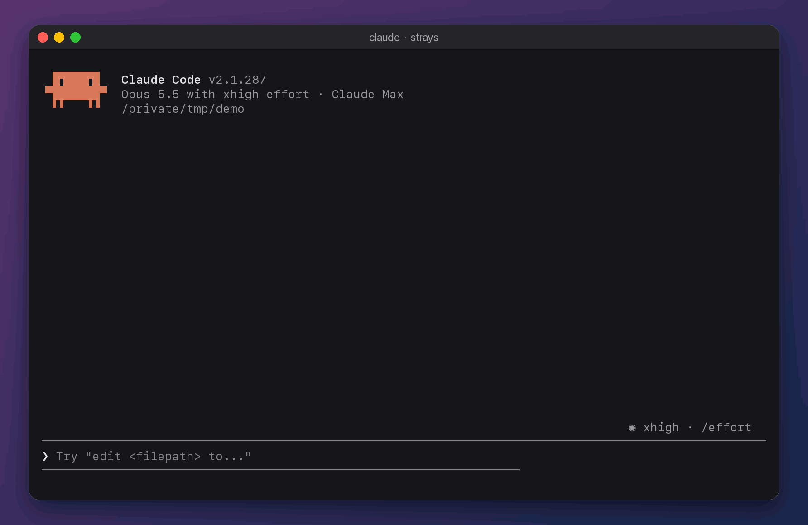

# strays

Claude Code starts a dev server, a watcher or a headless browser, moves on, and
forgets it. The process keeps running after the session is closed, holding port
3000 and a gigabyte of memory until you hunt it down with `lsof` or restart your
Mac.

`strays` is a Claude Code mod that finds every process Claude Code started and
left running, in any session, with its port and memory, and ends it for you.



```
❯ /strays
👻 Left behind session closed
   1  :3000 :24678  🟩 node vite --host                 67 MB  1h 11m  shop
   2  :8000         🐍 Python manage.py runserver 8000   9 MB  1h 11m  api
   3  ·             🟩 node browser.mjs                 654 MB   1h 8m  site
🌙 In the background session still open
   4  :5432         🐚 nc -lk 5432                        2 MB      8m  blog
   5  ·             👀 tail -f build.log                  1 MB      8m  blog
/strays 1 shows one in full · /strays kill 1 ends it · /strays ui opens the panel
```

## Install

Needs **macOS** and **Claude Code 2.1.287 or later** (check with `claude --version`).

In a Claude Code session in your terminal, type:

```
/plugin marketplace add huynamboz/strays
/plugin install strays@strays
```

Pick the user scope, and it runs in every session from then on. Type `/strays`.

Or from a shell:

```bash
claude plugin marketplace add huynamboz/strays
```

```bash
claude plugin install strays@strays
```

In the Claude desktop app, where `/plugin` does not run: click **+** next to the
prompt box, then **Plugins**, **Add marketplace** with `huynamboz/strays`, then
**Add plugin**.

To update, then restart Claude Code:

```bash
claude plugin marketplace update strays && claude plugin update strays@strays
```

To remove:

```bash
claude plugin uninstall strays@strays
```

## Use

| Command | Does |
| :- | :- |
| `/strays` | in the terminal and the desktop app, opens the panel; in VS Code and `claude -p`, prints the list |
| `/strays ls` | the list, each row numbered, wherever you are (also `l`, `list`) |
| `/strays 2` | row 2 in full: folder, command, program, start time, memory, its processes, the session that started it (also `i 2`, `info 2`, `show 2`) |
| `/strays :3000` | the same, for whatever listens on port 3000 |
| `/strays kill 2` | ends row 2 and everything it started (also `k`, `end`, `stop`; a pid or `:port` names one too) |
| `/strays kill all` | ends every left-behind one |
| `/strays copy 2` | copies row 2's whole command to the clipboard (also `c`, `cp`) |
| `/strays ui` | the panel, in the terminal and the desktop app (also `u`, `open`) |
| `/strays help` | this table |

`/ps` is the same command, shorter: `/ps`, `/ps 2`, `/ps k 2`.

In the VS Code panel, where text is not monospace and padded columns would not
line up, the list, one process in full and the help are drawn as tables: a port
is a link that opens it in the browser, memory is a bar as well as a number, and
the transcript of the session that started a process opens in the editor on a
click. The panel, the line under the prompt and the notice at a session's start
are not drawn there: VS Code shows a mod's text and nothing else.

A number names a row of the last list you printed, so `/strays ls` then
`/strays kill 3` ends what you saw as row 3.

### The panel

`/strays ui` opens a panel beside the transcript (or above the prompt in a
narrower window). It is made to be clicked:

- **click a row** to see that process in full, with buttons to end it, open its
  folder, open its port in the browser and copy its command
- **click End** on a row to end it: the button asks once (`Yes, end it`), and
  takes the question back after four seconds
- **End all left behind** ends every process whose session is closed

The keyboard works too: the arrows move, Enter presses, `o` twice ends all left
behind, `r` rescans, `m` shows the MCP servers and helpers of open sessions, `x`
closes. In the full view: `b` back, `e` end, `f` folder, `c` copy.

While anything is stray, a line under the prompt says how many and on which
ports; a session that starts while processes from earlier sessions still run
says so once.

## How it finds them

`bin/scan.sh` reads the process table and keeps a process when one of five
things ties it to Claude Code:

1. **Claude Code's mark.** Claude Code puts `CLAUDECODE=1`, its session's id and
   its own pid in the environment of every process it starts, and a process
   keeps its environment for life: after the session is gone, after `nohup`.
2. **The Bash tool's shell.** Every command the Bash tool runs is wrapped in a
   shell whose command line names `~/.claude/shell-snapshots`.
3. **Claude Code's own search.** Claude Code carries its own `rg`, `bfs` and
   `ugrep` and runs itself under their names. In a folder that is not a git
   repository, a session lists the files with that `rg` directly, not through
   the Bash tool, so the `rg` carries no mark; in a folder as large as your home
   it does not finish. A process named for one of the three whose program is
   another is Claude Code's. It shows under its session once it has run for a
   minute, and as left behind when the session is gone.
4. **The process tree.** Whatever hangs under a running session, or under such a
   shell. macOS shows no environment for its own programs (`sh`, `tail`, `nc`,
   `ssh`), so their place in the tree stands in.
5. **The process group.** One Bash call starts one process group, and a
   `nohup tail -f log &` stays in it after the shell that started it exits: a
   process that shares a group with a marked one, and whose group leader is gone
   or marked too, came from the same call.

Whether a session still runs is read from Claude Code's own registry,
`~/.claude/sessions/<pid>.json`, which also gives the session's name and folder
for the full view. `lsof` gives the listening ports and the folders. Nothing is
recorded as you work, so processes started before the mod was installed show up
too.

`bin/kill.sh` sends TERM, waits two seconds and sends KILL to what remains. A pid
can be handed to another program between the scan and the keypress, so it ends a
process only if it still started at the moment the scan saw, belongs to you, and
is not a Claude Code session.

## What it does not see

- **A system program cut loose alone.** A `nohup tail -f log &` that is the only
  thing its Bash call started shares its group with nothing marked: once the
  session is gone it cannot be told from anyone else's.
- **Docker containers**: the `docker` command exits and the container runs under the daemon.
- **Services handed to launchd**, and programs that clear their environment on start.
- Other users' processes.
- Linux and Windows: not yet. Linux needs `/proc/<pid>/environ` in place of `ps -E`.

## Privacy

strays reads the process table with `ps` and `lsof`, on your machine, when you
look. It makes no network calls, keeps no log, and ends nothing you did not
choose.

## Develop

```bash
git clone https://github.com/huynamboz/strays
cd strays
claude --plugin-dir .
```

```bash
claude plugin validate .
claude plugin test
npx -p typescript tsc -p .
```

`hooks/register.tsx` is the mod (commands, panel, status line), `hooks/procs.ts`
the logic it draws from, and `bin/` the shell scripts that scan, describe and
end processes. Linux support needs `bin/scan.sh` to read `/proc/<pid>/environ`
where it now reads `ps -E`; pull requests are welcome.

## License

MIT
